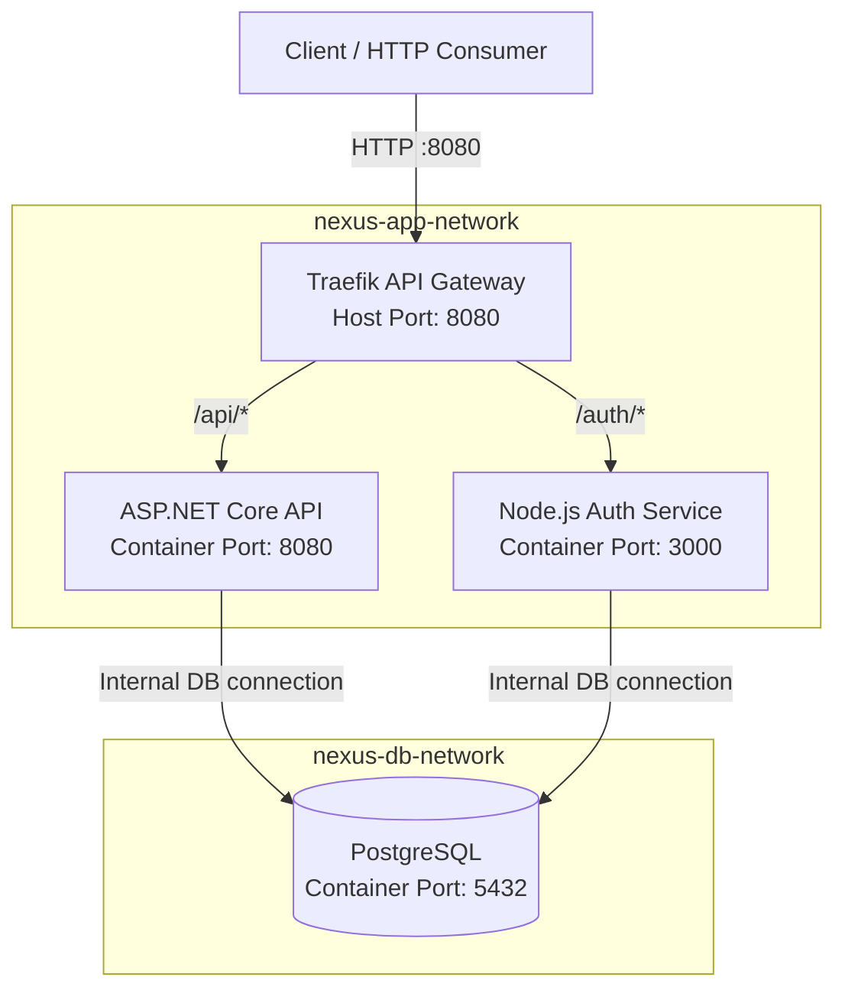

# NEXUS Gateway Architecture Design

## 1. Overview

This document defines the reverse proxy and API gateway architecture for NEXUS — Distributed Systems & Network Architecture Laboratory.

Phase 5 introduces **Traefik Proxy** as the controlled entry point for external HTTP traffic. Instead of clients connecting directly to individual application services, requests will enter through the gateway and be routed to the appropriate backend based on URL path prefixes.

The design builds on the Docker network segmentation introduced in Phase 4.

### Objectives

* Establish a single published entry point for application HTTP traffic.
* Route requests to the appropriate backend service using URL path prefixes.
* Use Docker-based service discovery.
* Preserve existing backend functionality.
* Remove direct host port exposure from API and Auth after gateway routing has been verified.
* Maintain database network isolation.
* Document traffic flow and security boundaries.

## 2. Current System Baseline

Before gateway implementation, the following services were verified as healthy.

| Component            | Host Port     | Status  |
| -------------------- | ------------- | ------- |
| ASP.NET Core API     | `5160`        | Healthy |
| Node.js Auth Service | `3000`        | Healthy |
| PostgreSQL           | Not published | Healthy |

The API connects to the `nexus` database, while the Auth service connects to `nexus_auth`.

These results establish the baseline for testing the gateway implementation.

## 3. Target Architecture



The two Docker networks are parallel connectivity domains, not sequential network layers.

API and Auth will be attached to both networks. Traefik will be attached to the application network, while PostgreSQL will remain attached only to the database network.

## 4. Technology Decisions

| Component             | Selected Technology | Purpose                                     |
| --------------------- | ------------------- | ------------------------------------------- |
| Reverse proxy         | Traefik Proxy       | Receives and routes incoming HTTP requests  |
| Container runtime     | Docker              | Runs the gateway and backend services       |
| Service orchestration | Docker Compose      | Defines services, networks and dependencies |
| Service discovery     | Docker provider     | Discovers eligible backend containers       |
| Application API       | ASP.NET Core        | Provides application endpoints              |
| Authentication        | Node.js and Express | Provides registration and login endpoints   |
| Database              | PostgreSQL          | Stores application and authentication data  |

Traefik is selected because it supports Docker-based service discovery and declarative routing configuration through container labels.

## 5. Request Routing Design

The gateway will use path-based routing.

| Public Path      | Backend Service  | Forwarded Path   |
| ---------------- | ---------------- | ---------------- |
| `/api/health`    | ASP.NET Core API | `/health`        |
| `/auth/register` | Node.js Auth     | `/auth/register` |
| `/auth/login`    | Node.js Auth     | `/auth/login`    |

### 5.1 API Routing

The ASP.NET Core API currently exposes its health endpoint at `/health`.

The gateway will match requests beginning with `/api/` and remove the `/api` prefix before forwarding them to the API service.

For example:

```text
Client request:
GET /api/health

Gateway forwards:
GET /health
```

This provides a consistent public API prefix without requiring the existing health endpoint to change.

### 5.2 Authentication Routing

The Auth service currently exposes registration and login endpoints under `/auth`.

The gateway will preserve this prefix when forwarding requests.

For example:

```text
Client request:
POST /auth/login

Gateway forwards:
POST /auth/login
```

The request body and HTTP method must also be preserved.

## 6. Network Architecture

NEXUS uses two explicitly defined Docker bridge networks.

### 6.1 Application Network

Network name: `nexus-app-network`

Planned membership:

* Traefik
* ASP.NET Core API
* Node.js Auth Service

This network enables the gateway to communicate with the backend services.

PostgreSQL will not be attached to this network.

### 6.2 Database Network

Network name: `nexus-db-network`

Planned membership:

* ASP.NET Core API
* Node.js Auth Service
* PostgreSQL

This network provides internal database connectivity.

The API and Auth services can reach PostgreSQL through Docker service discovery using the hostname `postgres` and port `5432`.

### 6.3 Network Membership Summary

| Service          | Application Network | Database Network |
| ---------------- | ------------------- | ---------------- |
| Traefik          | Yes                 | No               |
| ASP.NET Core API | Yes                 | Yes              |
| Node.js Auth     | Yes                 | Yes              |
| PostgreSQL       | No                  | Yes              |

The API and Auth services are dual-homed because they require both gateway-facing connectivity and database connectivity.

## 7. Security Boundaries

### 7.1 Controlled External Entry Point

Once gateway routing has been tested successfully, Traefik will be the only published application entry point.

The intended external access pattern is:

```text
Client
  |
  v
Host Port 8080
  |
  v
Traefik
  |
  +----> API
  |
  +----> Auth
```

Direct host port mappings for the API and Auth services will be removed after verification.

Their internal container ports will remain available to authorized containers on the relevant Docker networks.

### 7.2 Database Isolation

PostgreSQL will not publish port `5432` to the host.

Database connections will use Docker's internal network and service discovery.

This reduces direct host-level access to the database but does not replace database authentication, least-privilege permissions or secure credential management.

### 7.3 Docker Socket Access

Traefik's Docker provider requires access to Docker metadata to discover services.

Access to the Docker socket is security-sensitive because it can grant substantial control over the Docker environment. Its exposure will therefore be limited to the gateway's operational requirements and will not be published as a network service.

A Docker socket proxy or another restricted access mechanism can be considered as a future hardening improvement.

### 7.4 Dashboard Exposure

If the Traefik dashboard is enabled for development, it must remain restricted to local administrative access. It will not be exposed through a public gateway route.

### 7.5 HTTP and TLS

The initial gateway will use HTTP for local development.

TLS, certificate management and HTTPS redirection are deferred to a later security milestone.

## 8. Service Discovery

Traefik will use its Docker provider to discover the backend services.

Routing configuration will be associated with the relevant containers through Docker labels.

The design will explicitly configure the correct internal service ports:

* ASP.NET Core API: `8080`
* Node.js Auth Service: `3000`

The gateway must not attempt to route requests through the host-published API or Auth ports.

Traefik must also be configured to discover only appropriately labelled services, rather than automatically exposing every container it can inspect.

## 9. Port Exposure Strategy

### Before Gateway Implementation

| Service          | Published Host Port |
| ---------------- | ------------------- |
| Traefik          | Not yet configured  |
| ASP.NET Core API | `5160`              |
| Node.js Auth     | `3000`              |
| PostgreSQL       | None                |

### Target State

| Service          | Published Host Port | Internal Port                           |
| ---------------- | ------------------- | --------------------------------------- |
| Traefik          | `8080`              | `80` or the configured entry-point port |
| ASP.NET Core API | None                | `8080`                                  |
| Node.js Auth     | None                | `3000`                                  |
| PostgreSQL       | None                | `5432`                                  |

The Traefik container's internal entry-point port will be confirmed during implementation. The published host port and container port do not need to be the same.

Direct API and Auth port mappings will be removed only after the gateway passes its routing and connectivity tests.

## 10. Validation Plan

The gateway implementation will be considered successful when the following checks pass.

| Test                        | Expected Result                                            |
| --------------------------- | ---------------------------------------------------------- |
| Traefik starts successfully | Gateway container is running                               |
| `/api/health`               | Returns the API health response                            |
| `/auth/register`            | Reaches the Auth registration endpoint                     |
| `/auth/login`               | Reaches the Auth login endpoint                            |
| API database health         | API can connect to `nexus`                                 |
| Auth database health        | Auth can connect to `nexus_auth`                           |
| Backend host port exposure  | API and Auth ports are no longer published after migration |
| PostgreSQL host exposure    | Port `5432` remains unpublished                            |
| Service discovery           | Traefik routes to the correct containers                   |
| Gateway logs                | No persistent routing or connectivity errors               |

Authentication tests must distinguish successful routing from successful authentication. For example, an invalid login may correctly return HTTP `401`, demonstrating that the request reached the Auth service.

## 11. Implementation Sequence

Phase 5 will follow these milestones:

1. **5.1 — Gateway Architecture Design:** establish routing, network and security decisions.
2. **5.2 — Add Traefik:** configure the gateway in Docker Compose.
3. **5.3 — API Routing:** configure and test `/api/*`.
4. **5.4 — Auth Routing:** configure and test `/auth/*`.
5. **5.5 — Service Discovery:** verify Docker-based backend discovery.
6. **5.6 — Remove Direct Host Exposure:** remove API and Auth host port mappings.
7. **5.7 — Connectivity and Isolation Tests:** verify routing, database access and port exposure.
8. **5.8 — Document Traffic Flow:** record the implemented architecture.
9. **5.9 — Capture Evidence:** save configuration, command output and test results.
10. **5.10 — Commit Phase 5:** commit and push the completed implementation.

## 12. Design Status

**Phase 5.1 defines the target architecture.** The routing rules, network membership and security decisions in this document are design intentions until they have been implemented and verified.

The current API and Auth services have passed their baseline health checks. Traefik routing, service discovery and removal of direct host port mappings remain to be implemented and tested.

The next milestone is **Phase 5.2 — Add Traefik to Docker Compose**.