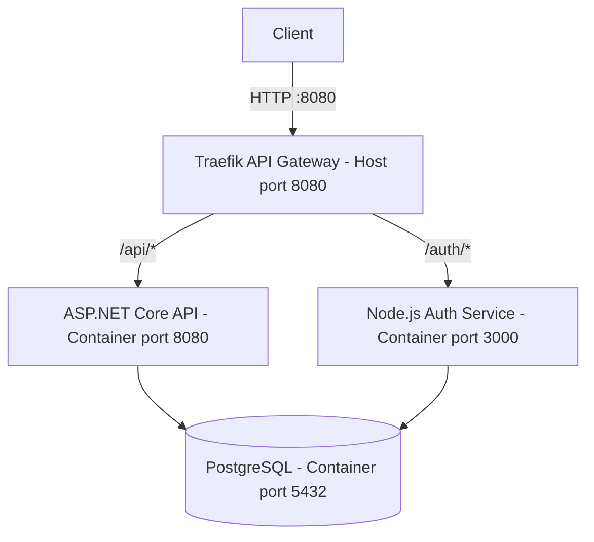

# NEXUS — Phase 5: Reverse Proxy and API Gateway

## Objective

Introduce Traefik as the single published HTTP entry point for the NEXUS application services. The gateway routes requests to the ASP.NET Core API and Node.js authentication service while keeping their container ports unpublished on the host.

## Architecture

Traefik is the published entry point. The API and Auth services use the application network to communicate with the gateway and the database network to reach PostgreSQL. PostgreSQL is not connected to the application network.

## Components

| Component        | Container port | Published host port |
| ---------------- | -------------: | ------------------- |
| Traefik          |             80 | 8080                |
| ASP.NET Core API |           8080 | None                |
| Node.js Auth     |           3000 | None                |
| PostgreSQL       |           5432 | None                |

## Routing Rules

| Public path             | Destination path   | Behavior             |
| ----------------------- | ------------------ | -------------------- |
| `/api/health`           | `/health`          | API health           |
| `/api/health/database`  | `/health/database` | API database health  |
| `/auth/health`          | `/health`          | Auth health          |
| `/auth/health/database` | `/health/database` | Auth database health |
| `/auth/login`           | `/auth/login`      | Auth login           |
| `/auth/register`        | `/auth/register`   | Auth registration    |

The API router strips the `/api` prefix before forwarding requests. The Auth router preserves authentication paths. A more specific Auth health router strips `/auth` only for the two health paths.

The gateway forwards requests to the container ports, not host-published backend ports.

## Network Segmentation

NEXUS uses two Docker bridge networks.

### Application Network

Network: `nexus-app-network`

Connected services:

* Traefik
* ASP.NET Core API
* Node.js Auth service

This network allows Traefik to communicate with the application services. PostgreSQL is not connected to this network.

### Database Network

Network: `nexus-db-network`

Connected services:

* ASP.NET Core API
* Node.js Auth service
* PostgreSQL

This network allows the API and Auth services to connect to PostgreSQL through the Docker service hostname `postgres` on port `5432`.

### Network Membership

| Service          | Application network | Database network |
| ---------------- | ------------------- | ---------------- |
| Traefik          | Yes                 | No               |
| ASP.NET Core API | Yes                 | Yes              |
| Node.js Auth     | Yes                 | Yes              |
| PostgreSQL       | No                  | Yes              |

The API and Auth services connect to both networks because they need gateway-facing connectivity and database access.

## Gateway Configuration

Traefik is configured through Docker Compose with:

* Image: `traefik:v3.6.1`
* Docker provider enabled for service discovery
* Automatic exposure of containers disabled
* HTTP entry point on container port `80`
* Host port `8080` mapped to Traefik port `80`
* Dashboard API enabled, with insecure dashboard exposure disabled
* Docker socket mounted at `/var/run/docker.sock`

Traefik discovers eligible backend services through Docker labels. Explicit service-port labels identify the API's container port `8080` and Auth's container port `3000`.

### Docker Socket Security

The Docker socket provides access to the Docker API. Mounting it with the `:ro` option does not make Docker API operations read-only. Access to the Docker socket is security-sensitive because it can grant substantial control over the Docker environment.

A restricted Docker socket proxy or another access-control mechanism should be considered as a future hardening improvement.

## Port Exposure Strategy

| Service          | Published host port | Internal container port |
| ---------------- | ------------------- | ----------------------- |
| Traefik          | `8080`              | `80`                    |
| ASP.NET Core API | None                | `8080`                  |
| Node.js Auth     | None                | `3000`                  |
| PostgreSQL       | None                | `5432`                  |

Traefik is the only service with a published application port. The API, Auth and PostgreSQL services remain accessible through their relevant Docker networks without direct host port mappings.

This reduces direct host-level exposure but does not replace authentication, authorization, database access controls or secure credential management.

## Verification Performed

The following checks were performed during implementation:

* `docker compose config --quiet` completed successfully.
* Traefik started successfully after its image was upgraded to `traefik:v3.6.1` to resolve a Docker provider compatibility issue.
* API health was reachable through `/api/health`.
* API database health returned `healthy` with `canConnect: true`.
* Auth health returned `healthy` through `/auth/health`.
* Auth database health returned `healthy` through `/auth/health/database`.
* Registration through `/auth/register` returned HTTP `201` for a test account.
* Repeating the registration returned HTTP `409` because the username already existed.
* API and Auth host port mappings were removed after gateway routing was verified.
* PostgreSQL remained healthy and had no published host port.
* The Traefik logs were checked for recent provider errors.

The registration test demonstrates that the request reached the Auth registration endpoint and that duplicate-user handling worked. It does not, by itself, verify the full login or authorization flow.

## Current Limitations and Follow-up

* The API health response currently omits the `service` field. This is an application response detail, not a gateway routing failure.
* The gateway currently uses HTTP. TLS, HTTPS redirection and production domain configuration are deferred.
* Docker socket access should be further restricted in a future security phase.
* Authentication, authorization, JWT handling and credential hardening remain future security work.
* The Traefik dashboard is not intentionally published as a public route.
* A successful health check confirms service availability, not complete application correctness or production readiness.

## Outcome

Phase 5 establishes Traefik as the single published application entry point, routes API and authentication traffic by path, and preserves the existing segmented Docker network architecture.

The gateway implementation and the documented verification results provide the foundation for the next phase: authentication and security hardening.